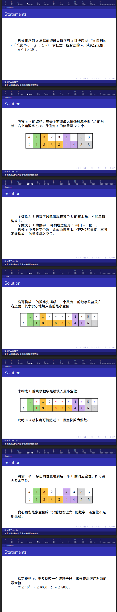

# 1.

https://codeforces.com/contest/2259/problem/D

三个MEX集合 A B C
假设我们让C 为0，那么我们可以将任意的垃圾数字扔到集合C中，只要其不为0

这样假设需要满足什么呢？
`MEXA + MEXB >= 2 * max(MEXA, MEXB)`
注意到，当`MEXA = MEXB` 时总是成立的

那么如何使`MEXA = MEXB`呢？
我们有一个很好的条件，可以将除0以外的任意数都扔到集合C中
假设有c个数x，我们可以分一个到A，分一个到B，其余都到C
如果`c = 1` ，那么就只分到C
想到这里，其实只要`x != 1` , 那么我们就将所有的x都加到C中
那么只有一种情况，当`cnt0 = 1` 时，无法构造，其他情况都可以

```c++
#include <bits/stdc++.h>  
using namespace std;  
#define int long long
#define endl '\n'
const int mod = 1e9 + 7;
const int MOD = 998244353;

void ap() {
	int n; cin >> n;
    vector<int> a(n);
    for (int & i : a) cin >> i;

    int cnt0 = 0;
    for (int & x : a) {
        if (x == 0) cnt0++;
    }

    if (cnt0 == 1) {
        cout << "NO" << endl;
        return;
    }

    map<int, vector<int>> op;
    for (int i = 0; i < n; i++) {
        int x = a[i];
        op[x].push_back(i);
    }

    vector<char> ans(n, '0');
    for (auto & [x, p] : op) {
        if (x == 0) {
            ans[p[0]] = 'A';
            ans[p[1]] = 'B';

            for (int i = 2; i < p.size(); i++) {
                ans[p[i]] = 'A';
            }
            continue;
        }

        //x > 1
        for (int i = 0; i < p.size(); i++) {
            ans[p[i]] = 'C';
        }

    }


    cout << "YES" << endl;
    for (auto & x : ans) {
        if (x == '0') x = 'A';
    }

    for (auto x : ans) cout << x;
    cout << endl;

	return ;
}

signed main() {
	ios::sync_with_stdio(false);
	cin.tie(nullptr);
	int T = 1;
	cin >> T;
	while (T--) {
		ap();
	} 
    return 0;
}
```


# 2.递归构造

https://codeforces.com/gym/106554/problem/D

```c++
#include <bits/stdc++.h>  
using namespace std;  
#define int long long
#define endl '\n'
const int mod = 1e9 + 7;
const int MOD = 998244353;

// 存储所有构造好的电梯路径
vector<vector<int>> elevators;

// 递归求解区间 [L, R] 内所有点对之间的直达覆盖
void build(int L, int R, int n) {
    int len = R - L + 1;
    if (len <= 1) return;

    if (len == 2) {
        // 只有 2 个点：覆盖边 (L, R)
        // 补齐全局端点 1 和 n
        vector<int> path;
        if (L != 1) path.push_back(1);
        path.push_back(L);
        path.push_back(R);
        if (R != n) path.push_back(n);
        elevators.push_back(path);
        return;
    }

    if (len == 3) {
        // 3 个点：L, L+1, R
        // 路径 1: 包含 (L, L+1) 和 (L+1, R)
        vector<int> p1;
        if (L != 1) p1.push_back(1);
        p1.push_back(L);
        p1.push_back(L + 1);
        p1.push_back(R);
        if (R != n) p1.push_back(n);
        elevators.push_back(p1);

        // 路径 2: 包含 (L, R)
        vector<int> p2;
        if (L != 1) p2.push_back(1);
        p2.push_back(L);
        p2.push_back(R);
        if (R != n) p2.push_back(n);
        elevators.push_back(p2);
        return;
    }

    // 1. 覆盖所有涉及 L 和 R 的边
    // 覆盖 (L, i) 和 (i, R)，其中 L < i < R
    for (int i = L + 1; i < R; i++) {
        vector<int> path;
        if (L != 1) path.push_back(1);
        path.push_back(L);
        path.push_back(i);
        path.push_back(R);
        if (R != n) path.push_back(n);
        elevators.push_back(path);
    }

    // 覆盖直连边 (L, R)
    vector<int> direct;
    if (L != 1) direct.push_back(1);
    direct.push_back(L);
    direct.push_back(R);
    if (R != n) direct.push_back(n);
    elevators.push_back(direct);

    // 2. 剥离外层 L 和 R，递归解决内部子区间 [L+1, R-1]
    build(L + 1, R - 1, n);
}

/*
f(k)
2 -> 1
3 -> 2
4 -> 4 -> 4 - 1 + f(2)
5 -> 6 -> 5 - 1 + f(3)
...
k -> k - 1 + f(k - 2);
*/

void ap() {
	int n; cin >> n;

    int dp[1005];
    dp[2] = 1;
    dp[3] = 2;
    for (int i = 4; i <= n; i++) {
        dp[i] = i - 1 + dp[i - 2];
    }

    cout << dp[n] << endl;
    
    build(1, n, n);

    // 快速输出所有电梯停靠层
    for (const auto& path : elevators) {
        for (int i = 0; i < (int)path.size(); i++) {
            cout << path[i] << (i + 1 == (int)path.size() ? "" : " ");
        }
        cout << "\n";
    }

	return ;
}

signed main() {
	ios::sync_with_stdio(false);
	cin.tie(nullptr);
	int T = 1;
//	cin >> T;
	while (T--) {
		ap();
	} 
    return 0;
}
```


# 3.从样例出发，固定构造形式

[D-Kaky 的竹林谜题_牛客小白月赛137](https://ac.nowcoder.com/acm/contest/139936/D)

```c++
void ap() {
	int n; cin >> n;
    
    if (n == 2 || n == 3 || n == 4 || n == 5) {
        cout << "No" << endl;
        return;
    }
    
    cout << "Yes" << endl;
    
    vector<int> a(n);
    int left = 2, right = n - 1;
    
    a[0] = 3, a[1] = 6;
    for (int i = 1; i <= n; i++) {
        if (i == 3 || i == 6) continue;
        
        if (a[i] % 2 == 0) {
            a[left++] = i;
        } else {
            a[right--] = i;
        }
    }
    
    for (int & x : a) cout << x << ' ';
    cout << endl;
    for (int i = n - 1; i >= 0; i--) cout << a[i] << ' ';
    cout << endl;
    
    
    
	return ;
}
```


# 4. 环形填充

[D-小月的地砖_牛客周赛 Round 163](https://ac.nowcoder.com/acm/contest/140737/D)

```c++
#include <bits/stdc++.h>  
using namespace std;  
#define int long long
#define endl '\n'
const int mod = 1e9 + 7;
const int MOD = 998244353;

void ap() {
	int n, m; cin >> n >> m; 
    vector<int> a(n);
    for (int & i : a) cin >> i;
    
    vector<vector<int>> b(n, vector<int> (m, 0));
    
    int p = 0;
    int t = 0;
    for (int & x : a) {
        for (int i = 0; i < x; i++) {
            b[t][p % m] = 1;
            p++;
        }
        
        t++;
    }
    
    for (int i = 0; i < n; i++) {
        for (int j = 0; j < m; j++) {
            cout << b[i][j];
        }
        cout << endl;
    }
    
	return ;
}

signed main() {
	ios::sync_with_stdio(false);
	cin.tie(nullptr);
	int T = 1;
//	cin >> T;
	while (T--) {
		ap();
	} 
    return 0;
}
```

# 5.

[H-那天晚上的回忆——努力换来的金牌_2026江西八校联盟程序设计联赛（第三场）](https://ac.nowcoder.com/acm/contest/141353/H)

教练会从所有的奖牌中选择一块金牌，然后从这块金牌的右边的所有奖牌中选择一块银牌，再从这块银牌右边的所有奖牌中选择一块铜牌。教练希望总共有𝑘种选法。

一个奖牌序列。金牌用 G 表示，银牌用 S 表示，铜牌用 B 表示。要求按照教练选择奖牌的方式有恰好𝑘种选法。要求 G 的数量不超过 26，S 的数量不超过 1000，B 的数量不超过 1000。

本题答案不唯一，符合要求的任意一组构造均判定为正确。

```c++
#include <bits/stdc++.h>  
using namespace std;  
#define int long long
#define endl '\n'
const int mod = 1e9 + 7;
const int MOD = 998244353;

void ap() {
	int k; cin >> k;
    
    cout << 'G';
    
//     if (k < 500) {
//         cout << 'S';
//         for (int i = 0; i < k; i++) cout << 'B';
//         return;
//     }

    int t = k / 500;
    int r = k % 500;
    
    for (int i = 0; i < t; i++) cout << 'S';
    for (int i = 0; i < 500 - r; i++) cout << 'B';
    cout << 'S';
    for (int i = 0; i < r; i++) cout << 'B';
    
    
	return ;
}

signed main() {
	ios::sync_with_stdio(false);
	cin.tie(nullptr);
	int T = 1;
//	cin >> T;
	while (T--) {
		ap();
	} 
    return 0;
}
```

# 6.

[E-小红的排列构造_牛客周赛 Round 164](https://ac.nowcoder.com/acm/contest/141142/E)

```c++
#include <bits/stdc++.h>  
using namespace std;  
#define int long long
#define endl '\n'
const int mod = 1e9 + 7;
const int MOD = 998244353;

//5 3 1 2 4
//4 2 3 1

void ap() {
	int n, k; cin >> n >> k;
    
    if (k > (n + 1) / 2) {
        cout << "No" << endl;
        return;
    }
    
    cout << "Yes" << endl;
   
    int t = n;
    while (k--) {
        cout << t << ' ';
        t -= 2;
    }

    for (int i = n - 1; i >= ((n & 1) ? 2 : 1); i -= 2) cout << i << ' ';
    for (int i = t; i >= ((n & 1) ? 1 : 2); i -= 2) cout << i << ' ';
    
    
	return ;
}

signed main() {
	ios::sync_with_stdio(false);
	cin.tie(nullptr);
	int T = 1;
//	cin >> T;
	while (T--) {
		ap();
	} 
    return 0;
}
```

# 7. 贪心 + 构造

https://codeforces.com/gym/106532/problem/H

把有正贡献的贪心的从大到小 两两放到长度为2的子序列中，使得贡献都可以加起来
剩余的都放到最后一个数的子序列中

```c++
#include <bits/stdc++.h>  
using namespace std;  
#define int long long
#define endl '\n'
const int mod = 1e9 + 7;
const int MOD = 998244353;

bool cmp(const array<int, 2> & a, const array<int, 2> & b) {
    return a[0] > b[0];
}

//把有正贡献的贪心的从大到小 两两放到长度为2的子序列中，使得贡献都可以加起来
//剩余的都放到最后一个数的子序列中

void ap() {
	int n, k; cin >> n >> k;
    vector<int> a(n);
    for (int & i : a) cin >> i;

    int cnt = 0;
    vector<array<int, 2>> b(n - 1);
    for (int i = 0; i < n - 1; i++) {
        b[i] = {a[i], i};

        if (a[i] > 0) cnt++;
    }
    sort(b.rbegin(), b.rend());

    if (cnt == 0) {
        cout << b[0][0] + a.back() << endl;
        for (int i = 0; i < n; i++) cout << 1 << ' ';
        return;
    }

    vector<int> ans(n);
    int idx = 1;
    
    int m = min({2 * k - 1, n - 1, cnt});
    
    int sum = a.back();
    for (int i = 0; i < m; i++) {
        sum += b[i][0];
    }


    int mn = (m % 2 != 0) ? (m - 1) : (m - 2);
    int i = 0;
    for (; i < mn; i += 2) {
        ans[b[i][1]] = ans[b[i + 1][1]] = idx++;
    }

    // 若 m 为偶数，留出一个单元素正数序列
    if (m % 2 == 0) {
        ans[b[i++][1]] = idx++;
    }

    for (int j = 0; j < n; j++) {
        if (ans[j] == 0) ans[j] = idx;
    }

    cout << sum << endl;
    for (int x : ans) cout << x << ' ';
    cout << endl;


	return ;
}

signed main() {
	ios::sync_with_stdio(false);
	cin.tie(nullptr);
	int T = 1;
//	cin >> T;
	while (T--) {
		ap();
	} 
    return 0;
}
```


# 8.

https://codeforces.com/contest/2261/problem/D1

```c++
#include <bits/stdc++.h>  
using namespace std;  
#define int long long
#define endl '\n'
const int mod = 1e9 + 7;
const int MOD = 998244353;

void ap() {
	int n, m; cin >> n >> m;

    if (n == 1) {
        cout << 0 << endl;
        return;
    }

    int k = (n + 1) / 2;
    cout << k << endl;
    for (int i = 1; i <= k; i++) {
        cout << i << ' ' << i + k - 1 << endl;
    }

	return ;
}

signed main() {
	ios::sync_with_stdio(false);
	cin.tie(nullptr);
	int T = 1;
	cin >> T;
	while (T--) {
		ap();
	} 
    return 0;
}
```


# 9.前缀最大值序列 + 贪心构造

https://codeforces.com/gym/106567/problem/I



数字大的`L` 能放的可能性越大
从右往左放，大的贪心的越长越好，遇到最左边0就break

如果遇到数量为1的数字，此时就需要将这个数字放到L的右上去
- 如果不能放，则后面的数字都小于这个数，一定不可以放到比其小的数字的右上
为此，记录可以放的位置数组为pos

最后
剩下的数字一定`<=` `L` 中的数


```c++
#include <bits/stdc++.h>
#include <cassert>

void solve() {
    int n;
    std::cin >> n;

    std::vector<int> c(2 * n);
    for (int i = 0; i < 2 * n; i++) {
        std::cin >> c[i];
        c[i]--;
    }

    std::vector<int> cnt(n);
    for (int i = 0; i < 2 * n; i++) {
        cnt[c[i]]++;
    }

    std::vector<int> ans(n, -1);
    int p = n - 1;

    std::vector<int> pos;
    for (int x = n - 1; x >= 0; x--) {
        if (cnt[x] > 1) {
            int k = std::max(0, p - cnt[x] + 2);
            ans[k] = x;
            cnt[x] -= p - k + 2;

            for (int i = k + 1; i <= p; i++) {
                pos.push_back(i);
            }

            p = k - 1;
            if (p == -1) {
                break;
            }
        } else if (cnt[x] == 1) {
            if (pos.empty()) {
                std::cout << "No\n";
                return;
            }
            ans[pos.back()] = x;
            pos.pop_back();
            cnt[x]--;
        }

    }

    if (p != -1) {
        std::cout << "No\n";
        return;
    }

    std::cout << "Yes\n";
    int x = 0;
    for (int i = 0; i < n; i++) {
        if (ans[i] == -1) {
            while (cnt[x] == 0) {
                x++;
            }
            ans[i] = x;
            cnt[x]--;
        }
    }

    for (int x = 0; x < n; x++) {
        assert(cnt[x] == 0);
    }

    for (int i = 0; i < n; i++) {
        std::cout << ans[i] + 1 << " \n"[i == n - 1];
    }
}

int main() {
    std::ios::sync_with_stdio(false);
    std::cin.tie(nullptr);

    int t;
    std::cin >> t;

    while (t--) {
        solve();
    }

    return 0;
}
```


# 10.固定构造

https://codeforces.com/contest/2254/problem/D

这个构造非常清楚，不需要贪心，简单模拟即可
但是需要注意要维护的量

```c++
#include <bits/stdc++.h>  
using namespace std;  
#define int long long
#define endl '\n'
const int mod = 1e9 + 7;
const int MOD = 998244353;

void ap() {
	int n; cin >> n;
    vector<int> b(n);
    for (int & i : b) cin >> i;

    map<int, int> cnt;
    for (int & x : b) cnt[x]++;

    if (cnt.begin()->first != 0) {
        cout << -1 << endl;
        return;
    }

    array<int, 2> last{-1, -1};//sum, c
    int pre = 0;

    map<int, int> ans; //b[i], ans_val
    for (auto [x, c] : cnt) {
        if (x == 0) {
            last = {0, c};
            continue;
        }

        int cnt = last[1];
        int s = x - last[0];
        if (s % cnt != 0) {
            cout << -1 << endl;
            return;
        }

        int t = s / cnt;
        if (t <= pre) {
            cout << -1 << endl;
            return;
        }
        
        ans[last[0]] = t;
        pre = t;
        last = {x, c};
    }

    ans[last[0]] = pre + 1;
    for (int & x : b) cout << ans[x] << ' ';

    cout << endl;


	return ;
}

signed main() {
	ios::sync_with_stdio(false);
	cin.tie(nullptr);
	int T = 1;
	cin >> T;
	while (T--) {
		ap();
	} 
    return 0;
}
```


# 11. 证明构造

https://codeforces.com/gym/105911/problem/M

前k个放第一堆，不flip
后n - k个放第二堆，全都flip

证明：
- 假设第一堆中有`x`个正面朝上
- 则第二堆不flip时，有`n - k - x` 个正面朝上
- 第二堆全都flip后，有`n - k - (n - k - x) = x` 个正面朝上
- 得证

```c++
#include <bits/stdc++.h>  
using namespace std;  
#define int long long
#define endl '\n'
const int mod = 1e9 + 7;
const int MOD = 998244353;

void ap() {
	int n, k; cin >> n >> k;

    for (int i = 0; i < k; i++) cout << 1;
    for (int i = 0; i < n - k; i++) cout << 4;

	return ;
}

signed main() {
	ios::sync_with_stdio(false);
	cin.tie(nullptr);
	int T = 1;
//	cin >> T;
	while (T--) {
		ap();
	} 
    return 0;
}
```

# 12.前缀异或和 - 构造

https://codeforces.com/problemset/problem/2271/C


```c++
#include <bits/stdc++.h>  
using namespace std;  
#define int long long
#define endl '\n'
const int mod = 1e9 + 7;
const int MOD = 998244353;

void ap() {
	int n; cin >> n;

    int x = 1;
    while (2 * x <= n) x *= 2;

    vector<int> p;
    for (int i = 0; i < x; i++) p.push_back(i);
    for (int i = x - 1; i >= 0; i--) p.push_back(i);
    for (int i = x; i < 2 * x; i++) p.push_back(i);
    for (int i = 2 * x - 1; i >= x; i--) p.push_back(i);

    cout << p.size() - 1 << endl;
    for (int i = 1; i < p.size(); i++) cout << (p[i] ^ p[i - 1]) << ' ';
    cout << endl;

	return ;
}

signed main() {
	ios::sync_with_stdio(false);
	cin.tie(nullptr);
	int T = 1;
	cin >> T;
	while (T--) {
		ap();
	} 
    return 0;
}
```

# 13. 位运算 + 构造

https://codeforces.com/gym/106565/problem/D

异或和为x，令x的二进制最高位为第k位

- `a[i] ^ x < a[i]` ，高k位全为0不会影响，第k位为1会影响
- 如果`a[i]` 第k位为1，显然成立，满足`s[i] = 1`

- 反之，如果`a[i]` 第k位为0，满足`s[i] = 0`

- 由此可以构造
- `a[i] = (1LL << k) + i + 1 , s[i] = 1`
- `a[i] = i + 1 , s[i] = 0`

- 第k位可以任意构造，可构造一个最大的，不会影响低位，即`k = 59`
- 如果s中1的个数为偶数，则第k位的1会抵消，将s中的任一个翻转即可

```c++
#include <bits/stdc++.h>  
using namespace std;  
#define int long long
#define endl '\n'
const int mod = 1e9 + 7;
const int MOD = 998244353;

void ap() {
	string s; cin >> s;
    int n = s.size();

    int x = (1LL << 59);

	int cnt = 0;
	for (char & c : s) if (c == '1') cnt++;

	if (cnt % 2 == 0) {
		s[0] = (s[0] == '1' ? '0' : '1');
	}

	for (int i = 0; i < n; i++) {
		if (s[i] == '1') {
			cout << x + i + 1 << ' ';
		} else {
			cout << i + 1 << ' ';
		}
	}

	return ;
}

signed main() {
	ios::sync_with_stdio(false);
	cin.tie(nullptr);
	int T = 1;
//	cin >> T;
	while (T--) {
		ap();
	} 
    return 0;
}
```


# 14.  推式子 - 唯一构造

https://codeforces.com/contest/2290/problem/F

```c++
#include <bits/stdc++.h>  
using namespace std;  
#define int long long
#define endl '\n'
const int mod = 1e9 + 7;
const int MOD = 998244353;

//bx = pos + x - n - 1;

void ap() {
	int n; cin >> n;
    vector<int> b(n + 1);
    for (int i = 1; i <= n; i++) cin >> b[i];

    vector<int> ans(n + 1);
    for (int i = 1; i <= n; i++) {
        int pos = b[i] - i + n + 1;

        if (pos < 1 || pos > n || ans[pos] != 0) {
            cout << -1 << endl;
            return;
        }

        ans[pos] = i;
    }

    for (int i = 1; i <= n; i++) cout << ans[i] << ' ';
    cout << endl;


	return ;
}

signed main() {
	ios::sync_with_stdio(false);
	cin.tie(nullptr);
	int T = 1;
	cin >> T;
	while (T--) {
		ap();
	} 
    return 0;
}
```

# 15. 矩阵输出构造

https://codeforces.com/gym/106589/problem/D

```c++
#include <bits/stdc++.h>  
using namespace std;  
#define int long long
#define endl '\n'
const int mod = 1e9 + 7;
const int MOD = 998244353;

void ap() {
	int n, m; cin >> n >> m;

    if (m > n) {
        cout << "NO" << endl;
        return;
    }

    cout << "YES" << endl;

    if (m == 0) {
        for (int i = 0; i < n; i++) {
            for (int j = 0; j < n; j++) cout << 1;
            cout << endl;
        }
        return;
    }

    for (int i = 0; i < n; i++) {
        for (int j = 0; j < n; j++) {
            if (i + j < m - 1) cout << 1;
            else cout << 0;
        }
        cout << endl;
    }


	return ;
}

signed main() {
	ios::sync_with_stdio(false);
	cin.tie(nullptr);
	int T = 1;
//	cin >> T;
	while (T--) {
		ap();
	} 
    return 0;
}
```

# 16. 分块处理 + 双指针

https://codeforces.com/gym/106589/problem/F


> **结论**
> $$\text{有解} \iff \forall i, \ a_i \le i.$$

若存在 $a_i > i$，则位置 $i, i+1, \dots, n$ 的初值都至少为 $a_i$，且操作不能减小。最终这些位置也都至少为 $a_i$。但排列中至少为 $a_i$ 的数只有 $n - a_i + 1$ 个，位置数有 $n - i + 1$ 个。因为 $a_i > i$，数量不够，所以无解。

下面说明若所有 $a_i \le i$，一定可以构造。

---

从左到右扫描，维护当前边界 $l$，使得 $a_l = l$，且 $l$ 之前的位置已经被划分成若干个排列块，之后不再使用这些位置。若 $a_{l+1} = l + 1$，直接令 $l \leftarrow l + 1$。

否则有 $a_{l+1} < l + 1$。由于 $a_l = l$ 且未处理后缀仍保持非降，可知 $a_{l+1} = l$。令 $r > l$ 为第一个满足 $a_r = r$ 的位置；若不存在，则令 $r = n + 1$。接下来只处理半开区间 $[l, r)$。

对 $x = l + 1, l + 2, \dots, r - 1$ 依次执行：

* 先操作一次下标 $l + 1$。因为 $a_{l+1} = l$ 始终不变，所以这会令 $a_l$ 增加 $1$，此时 $a_l = x$；
* 再操作若干次下标 $l$，直到 $a_x = x - 1$。此时操作 $l$ 正好会令 $a_{a_l} = a_x$ 增加 $1$。

处理完后，区间 $[l, r)$ 变为 $[r - 1, l, l + 1, \dots, r - 2]$，恰好是 $l, l + 1, \dots, r - 1$ 的一个排列。随后令 $l \leftarrow r$ 继续扫描即可。

---

每次操作都会使序列总和增加 $1$，最终序列是 $1, 2, \dots, n$ 的排列，因此操作次数为

$$\frac{n(n + 1)}{2} - \sum_{i=1}^n a_i \le \frac{n(n - 1)}{2}$$

时间复杂度 $O(n^2)$，瓶颈只来自于记录操作。如果输出的是压缩后的操作方案（对下标 $i$ 连续操作 $k$ 次），复杂度可做到 $O(n)$。

Bonus: 将正整数序列改为整数序列。


tips:
- 画下标`id` 和 值`a[id]` 对应的图会更好理解
- 将`a[idx] = idx` 的点作为分界点，处理不满足这个的区间
- `a[1] = 1` ，并且每一个`a[idx] = idx` 的点都将作为分界点，因此对于不满足的区间`[l + 1, r)` ，恒有`a[l] = l && a[r] = r` 并且 `a[l + 1] = l`

- 画图可以直观理解
- `a[l + 1] = l`， 可以将其作为锚点，不改变他，那么每次操作`l + 1`都可以 将`a[l]++`
- 显然，一直操作`l + 1` 则可以使`a[l]`一直增
- 在此基础上，如果我们操作`l` ，相当于可以操作下标为`a[l]` 的数
- 也就是说，我们可以从`idx = [l + 2, r - 1]` ，一个个的将`a[idx]++` 
- `a[idx]++` 操作可以自由操作，那么我们只需要维护`a[l]`的值即可
- 最后化为`[r - 1, l, l + 1, l + 2, ..., r - 2]` 

```c++
#include <bits/stdc++.h>  
using namespace std;  
#define int long long
#define endl '\n'
const int mod = 1e9 + 7;
const int MOD = 998244353;

void ap() {
	int n; cin >> n;
    vector<int> a(n + 1);
    for (int i = 1; i <= n; i++) cin >> a[i];

    bool ok = true;
    for (int i = 1; i <= n; i++) {
        if (a[i] > i) ok = false;
    }

    if (!ok) {
        cout << "NO" << endl;
        return;
    }

    cout << "YES" << endl;
    vector<int> ans; 


    int l = 1;
    while (l <= n) {
        if (l == n || a[l + 1] == l + 1) {
            l++;
            continue;
        }

        int r = l + 1;
        while (r <= n && a[r] < r) {
            r++;
        }


        for (int x = l + 1; x <= r - 1; x++) {
            ans.push_back(l + 1);
            
            int need = (x - 1) - a[x];
            for (int c = 0; c < need; c++) {
                ans.push_back(l);
            }
        }

        l = r;
    }

    cout << ans.size() << endl;
    for (int i = 0; i < ans.size(); i++) {
        cout << ans[i] << " ";
    }
    cout << endl;


	return ;
}

signed main() {
	ios::sync_with_stdio(false);
	cin.tie(nullptr);
	int T = 1;
	cin >> T;
	while (T--) {
		ap();
	} 
    return 0;
}
```


# 17. 周期数组

https://codeforces.com/problemset/problem/1348/B

要使一个数组对于某个 $k$ 而言是“美丽的”，该数组必须是周期数组，且周期为 $k$。如果数组 $a$ 中包含的互不相同的数字超过 $k$ 个，则不存在解，此时我们输出 `-1`（因为该数组不可能具有周期 $k$）。否则，我们提出以下构造方法。

考虑一个包含数组 $a$ 中所有不同数字的列表。如果其中不同的数字少于 $k$ 个，我们将追加一些 $1$（或任何其他数字），直到该列表的大小达到 $k$。我们只需将该列表打印 $n$ 次即可。数组 $b$ 的长度为 $nk$，这绝不会超过 $10^4$。数组 $b$ 总能通过向数组 $a$ 中插入一些数字来构造，因为 $a$ 中的每个数都对应一个列表。

时间复杂度为：$O(n \log n + nk)$


一个以 $k$ 为周期的数组，本质上是把一个长度为 $k$ 的循环节不断重复，因此整个数组中**最多只能出现 $k$ 种不同的数字**。

由于题目只允许**插入**元素，不能删除或修改原数组 $a$ 的元素，所以 $a$ 中的所有数字都必须保留在 $b$ 中。 因此，如果原数组 $a$ 中互不相同的数字个数 **严格大于 $k$**，那么无论怎么插入，都不可能变成周期为 $k$ 的数组，直接输出 `-1`

```c++
#include <bits/stdc++.h>  
using namespace std;  
#define int long long
#define endl '\n'
const int mod = 1e9 + 7;
const int MOD = 998244353;

void ap() {
    int n, k; cin >> n >> k;
    vector<int> a(n);
    set<int> st;
    for (int & i : a) {
        cin >> i;

        st.insert(i);
    }

    if (st.size() > k) {
        cout << -1 << endl;
        return;
    }

    cout << n * k << endl;
    for (int i = 0; i < n; i++) {
        for (auto x : st) cout << x << ' ';

        for (int j = 0; j < k - (int)st.size(); j++) cout << 1 << ' ';
    }

    cout << endl;


	return ;
}

signed main() {
	ios::sync_with_stdio(false);
	cin.tie(nullptr);
	int T = 1;
	cin >> T;
	while (T--) {
		ap();
	} 
    return 0;
}
```


# 18. 前驱贡献未定 + 贪心构造

https://codeforces.com/problemset/problem/2110/C

- 当目前高度`h < l`时，很显然可以贪心地利用前面的-1来填充
- 问题是，选前面的变为1会影响到之前的高度，而这个高度又可能会高于之前的限制r
- 如果当前高度需要之前的高度来填充，却使得之前的高度无法越过障碍
- 那么此时由于之前的限制，当前位置其实到不了

- 这样贪心会产生后效性，会有错误，该如何解决？

- 对于每一个位置，考虑要保证`h <= r` ，如果我们提前将多余的，会使`h > r` 的-1变为0
- 则可以保证这个位置不会影响后面的，即无后效性

```c++
#include <bits/stdc++.h>  
using namespace std;  
#define int long long
#define endl '\n'
const int mod = 1e9 + 7;
const int MOD = 998244353;

void ap() {
    int n; cin >> n;
    vector<int> d(n);
    for (int & i : d) cin >> i;

    vector<array<int, 2>> a(n);
    for (int i = 0; i < n; i++) cin >> a[i][0] >> a[i][1];

    int h = 0;
    vector<int> st;
    for (int i = 0; i < n; i++) {
        if (d[i] == -1) {
            st.push_back(i);
        } else {
            h += d[i];
        }

        while (h < a[i][0]) {
            if (st.empty()) {
                cout << -1 << endl;
                return;
            }

            d[st.back()] = 1;
            h++;
            st.pop_back();
        }

        while (h + st.size() > a[i][1]) {
            if (st.empty()) {
                cout << -1 << endl;
                return;
            }

            d[st.back()] = 0;
            st.pop_back();
        }
    }

    for (int & x : d) cout << max(0LL, x) << ' ';
    cout << endl;


	return ;
}

signed main() {
	ios::sync_with_stdio(false);
	cin.tie(nullptr);
	int T = 1;
	cin >> T;
	while (T--) {
		ap();
	} 
    return 0;
}
```